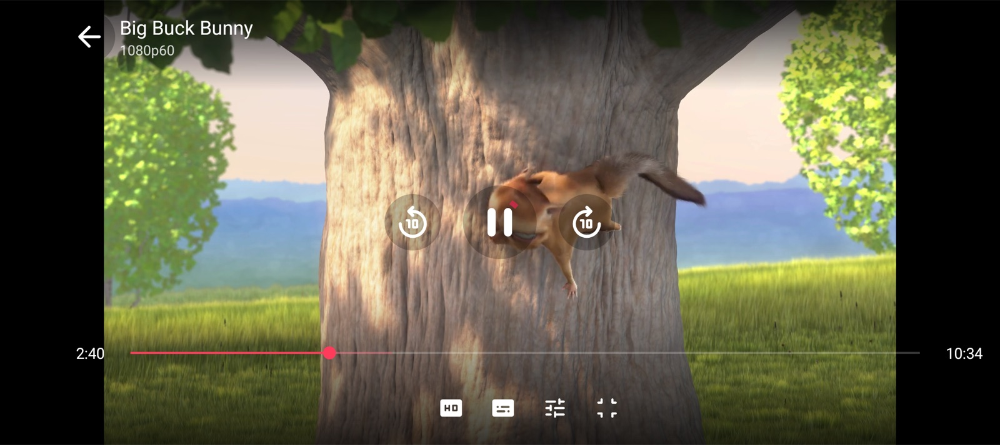
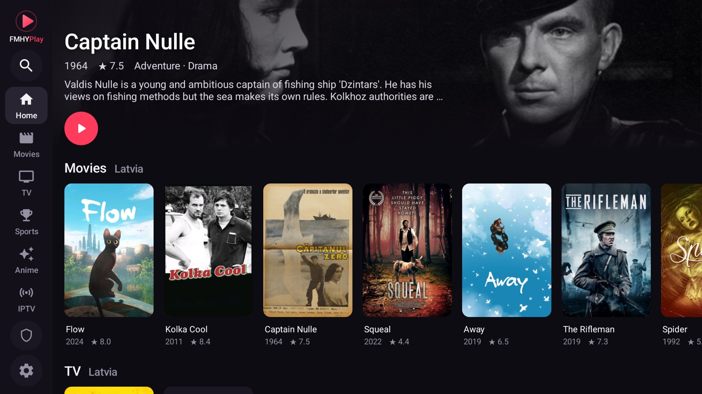
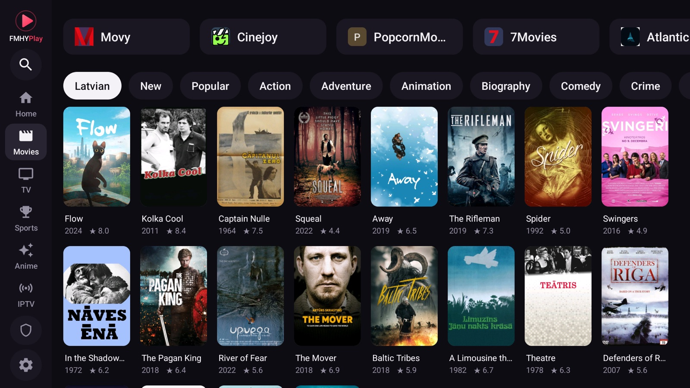
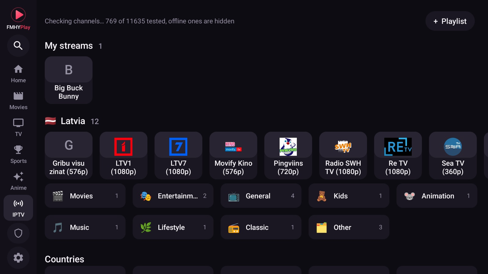
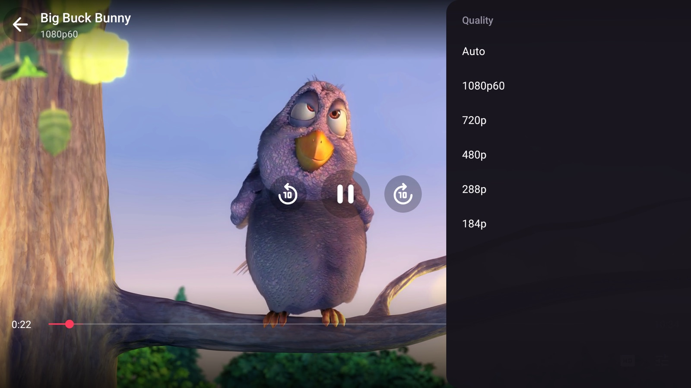
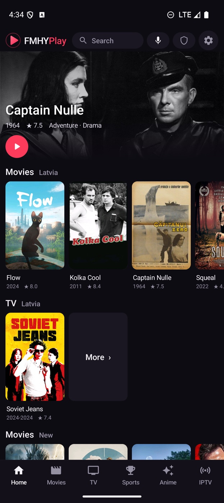
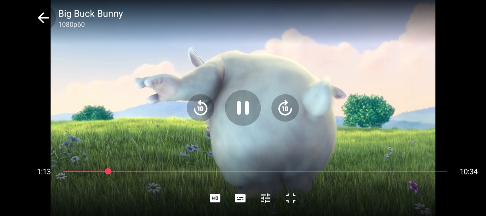

<p align="center">
  
</p>

<p align="center">
  <b>Any streaming site, a real player.</b><br>
  A TV-first Android app that opens the sites you choose, finds the video they play, and plays it in a native hardware-accelerated player.
</p>

<p align="center">
  <a href="https://github.com/fmhyplay/android/releases/latest"></a>
  <a href="https://github.com/fmhyplay/android/actions/workflows/build.yml"></a>
  
  
</p>

<p align="center">
  <a href="https://fmhyplay.github.io/android/">Documentation</a> ·
  <a href="https://github.com/fmhyplay/android/releases/latest">Download</a> ·
  <a href="https://fmhyplay.github.io/android/guide.html">User guide</a> ·
  <a href="https://fmhyplay.github.io/android/build.html">Build from source</a>
</p>

<p align="center">
  
</p>

## Why

Streaming sites are built for a desktop browser with a mouse. On a TV remote they are painful, they are full of pop-ups, and their embedded players stutter on weak hardware. FMHYPlay keeps the site (so you keep every title and server it offers) but takes over the part that goes wrong:

- It **finds the video stream** the page starts and plays it in ExoPlayer with the hardware decoder, with nothing painted over the picture.
- It **drives the site for you**: the player's Servers and Quality buttons press the site's own buttons, so you do not go back to the page to switch.
- It **blocks ads and pop-ups**, **tunnels the app's own traffic** through Cloudflare WARP when you want it, and works with a **TV remote** and with **touch**.

## Features

**Native player**
- Hands off automatically when a page starts an HLS or DASH stream; falls back to the page if the stream cannot be played
- Replays the page's Referer, Origin and cookies, so streams that check them still play
- Quality list with frame rate (for example 1080p60), audio and subtitle tracks, speed, and four zoom modes (Fit, Fill, Stretch, 16:9, 4:3)
- **Servers and Quality buttons that control the site's own player**, including players inside cross-origin iframes
- Episodes are picked in the site's own player: press Back, choose one there, and the new stream opens by itself once it differs from the one you left
- **OpenSubtitles** built in (search by title and episode, side-loaded without losing your place), plus subtitle size, position and timing (0.1 s steps)
- **Simkl** scrobbling (optional): connect with a code at simkl.com/pin, and titles you finish are marked watched
- Phone gestures: swipe up and down on the left half for brightness and on the right half for volume, double-tap either side to jump 10 seconds
- One layout on every screen size; resumes where you left off

**Browsing**
- A directory of streaming sites that tracks the [FMHY](https://github.com/fmhy/edit) lists and refreshes itself
- Movie and series catalog (posters, ratings, episodes) from Cinemeta, with search by typing or by voice
- Opens a title's own page on many sites instead of searching for it
- Continue watching, **favorites** for sites and channels (hold OK to mark one), and My list for titles
- **Add your own site**: any address becomes a favorite with the same player, ad blocking and remote control
- Dark pages (WebView dark mode), a remote-friendly cursor mode, and focus navigation designed for D-pads

**Network and privacy**
- **In-app Cloudflare WARP**: a userspace WireGuard tunnel for the app's traffic only, with no VPN permission and no root; LAN addresses stay direct
- Domain-based ad, tracker and pop-up blocking, plus redirect blocking
- No FMHYPlay account, no analytics, no telemetry. Updates come from this repository's releases, installed from inside the app

**IPTV**
- More than 11,000 public channels from [iptv-org](https://github.com/iptv-org/iptv), grouped by category and country, with logos
- A background check hides channels that are offline, and a Working list remembers the ones that played for you
- **Add your own playlist, a single `.m3u8` stream link or an Xtream Codes login**; each playlist gets its own named row at the top. Links on your own network work too
- Star channels, filter, and search by voice
- Optional extra source list that you host yourself (see [docs](https://fmhyplay.github.io/android/guide.html#sources))

**Engineering**
- Plain Java and SDK command-line tools, **no Gradle**, roughly 11 MB per APK
- Reproducible CI build and signed releases from a tag

## Screenshots

<table>
  <tr>
    <td></td>
    <td></td>
  </tr>
  <tr>
    <td></td>
    <td></td>
  </tr>
</table>

<p align="center">
  
  &nbsp;
  
</p>

## Install

Download the APK for your device from [Releases](https://github.com/fmhyplay/android/releases/latest):

| File | For |
| --- | --- |
| `FMHYPlay-TV-vX.Y.Z.apk` | Android TV, Google TV, Fire TV, boxes (adds the TV launcher entry) |
| `FMHYPlay-Android-vX.Y.Z.apk` | phones and tablets |

Allow installs from your file manager or browser, open the APK, done. On a TV, `adb install -r FMHYPlay-TV-vX.Y.Z.apk` works over the network. Updates install over the old version because releases are signed with the same key. Check a download with `SHA256SUMS.txt` from the release.

Requires Android 8.0 (API 26) or newer, arm64 or 32-bit ARM.

## Build from source

```sh
git clone https://github.com/fmhyplay/android
cd android
warp/build.sh      # builds the WARP helper (needs Go and the Android NDK)
./build.sh         # needs an Android SDK (platform 34, build-tools) and JDK 17+
```

The APKs appear in the project folder. Details, signing and the CI setup are in the [build guide](https://fmhyplay.github.io/android/build.html).

## How it works

1. The page loads in a WebView. A small script (`assets/frame.js`) runs in every frame, including cross-origin embeds.
2. The WebView's requests are watched for HLS and DASH playlists; some sites hide them behind URLs without an extension, so downloads are also recognised by their first bytes.
3. When a stream shows up, the page is paused and the stream goes to ExoPlayer with the same headers and cookies the page used.
4. The same script reads the page's server and quality lists. The player's buttons send a click back to it, the page switches, and the new stream is handed over the same way.

## Legal

FMHYPlay is a browser and a media player. It does not host, store, index or distribute any video, and it ships no list of streams. The sites it opens, the IPTV playlists it reads and the content they serve are provided by third parties; what you open and play is your responsibility, and you should only use content you have the right to watch. See [THIRD_PARTY.md](THIRD_PARTY.md) for the components and data sources it builds on. FMHYPlay is not affiliated with or endorsed by FMHY, Cloudflare, Stremio, OpenSubtitles, iptv-org or any streaming site.

## License

[MIT](LICENSE)
